  

  

<table>
<tr>
<td width="260" align="center"></td>
<td>

### Hi, I'm Claudio 👋

I build **AI products end to end, from the model to the app**, in the cloud or on the client's own
hardware, whichever the business needs: sensitive data stays protected, costs stay predictable, and
every delivery is checked automatically by tests and rules.

- 🧠 LLMs in the cloud or local: fine-tuning, 4-bit quantization, NPU and GPU inference
- 🤖 Coding agents gated by lint, build and tests
- 📱 Apps around the model: iOS, Windows, Android TV, web
- 🇧🇷 Goiânia, Brazil · Portuguese and written English

</td>
</tr>
</table>

## Selected work

| Project | What it shows |
|---|---|
| [**JuiceBar**](https://github.com/devBertini/juicebar) | Windows tray app in Rust: about **8 MB** of memory against the vendor software's 171 MB, measured |
| [**devBertini TV Launcher**](https://github.com/devBertini/devbertini-tv-launcher) | Android TV home in Flutter: from **30%** missed frames to **0 of 129** on the apps row, measured frame by frame |
| [**Bert1n1 IA**](https://github.com/devBertini/bert1n1IA) | VS Code extension: three agents on one local model, project RAG, gated by lint, build and tests |
| [**Swapdesk**](https://github.com/devBertini/swapdesk) | Open-source remote desktop for your own machines on the local network (coming soon) |
| [**KyAuto · KyPDF · KyPet**](https://devbertini.github.io/) | iOS apps on the App Store that work 100% offline: no account, no tracking |

## Tech I work with

  

## GitHub activity

  
  

  

<picture>
  <source media="(prefers-color-scheme: dark)" srcset="https://raw.githubusercontent.com/devBertini/devBertini/output/snake-dark.svg" />
  
</picture>

## Em português

Construo **produtos com IA de ponta a ponta, do modelo ao app**, na nuvem ou no hardware do cliente,
do jeito que o negócio precisa: dado sensível protegido, custo previsível e cada entrega
conferida automaticamente por testes e regras. Atendo empresas no Brasil e, por escrito, clientes de fora.

## Contact

  
  

